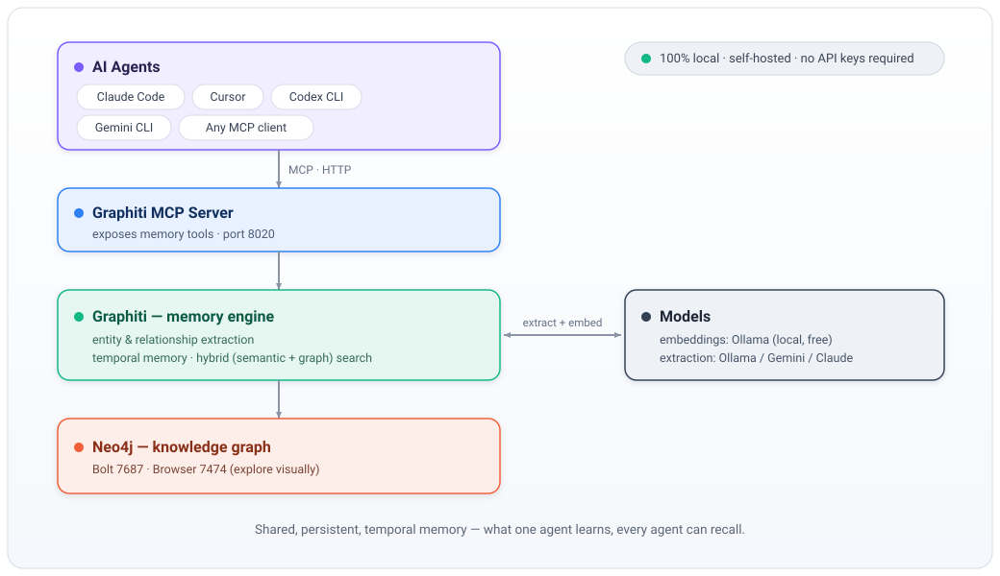

# 🧠 AI Second Brain

A **shared, persistent memory for your AI agents** — Claude Code, Cursor, Codex
CLI, Gemini CLI, Ollama-based agents, or any MCP-compatible client. Agents store
and retrieve knowledge from a **temporal knowledge graph**, so what one agent
learns becomes available to all the others.

Fully **self-hosted and local** (no cloud required, no API bills): a small Docker
stack plus your local [Ollama](https://ollama.com) models.

> 📌 **Este setup (Rafael):** para o estado atual da nossa instalação e como usar
> do Mac/rede como cliente, veja **[`docs/USO-SECOND-BRAIN.md`](docs/USO-SECOND-BRAIN.md)**.

<p align="center">
  
</p>

- **[Graphiti](https://github.com/getzep/graphiti)** — the memory engine
  (entity/relationship extraction, temporal memory, hybrid search) + MCP server.
- **[Neo4j](https://neo4j.com)** — the graph database.
- **[Ollama](https://ollama.com)** — local models for extraction + embeddings.

> This is a thin, well-documented wrapper around mature open-source projects —
> not a memory system built from scratch. It just wires them together with sane
> defaults so you can stand up a second brain in a few minutes.

---

## What you get

- ✅ Persistent memory shared by **multiple agents at once**
- ✅ A real **knowledge graph** (entities + relationships), not just embeddings
- ✅ **Temporal memory** — facts are versioned in time ("what does it use *now*
  vs. *before*?")
- ✅ **Hybrid search** (semantic + graph + keyword), works across languages
- ✅ **Group namespaces** (per project / topic) with cross-group search
- ✅ 100% local by default, with a one-line switch to a cloud LLM if you want
- ✅ **Automatic routing:** 1–4 memories stay on local Ollama (free); a burst of
  5+ uses your paid API so a CPU box is not crushed
- ✅ Backup & restore scripts, Neo4j Browser to explore the graph visually

---

## Requirements

- **Docker** + **Docker Compose v2** ([install](https://docs.docker.com/get-docker/))
- **[Ollama](https://ollama.com)** installed on your machine (recommended), or run
  it in a container (see [Ollama options](#ollama-options))
- **~6 GB free RAM** and **~7 GB disk** for the default local models
- Works on **macOS, Windows (WSL2), and Linux**

> ⚠️ **Performance:** the default extraction model runs on CPU unless you have a
> GPU. On a small/CPU-only machine, processing a memory can take a few minutes
> (it's asynchronous — it doesn't block your agent). If that's too slow, switch
> extraction to a fast cloud model — see [Choosing your extraction model](#choosing-your-extraction-model).

---

## Quick start

```bash
git clone https://github.com/abelgonzalezr/ai-second-brain.git
cd ai-second-brain
bash scripts/setup.sh
```

`setup.sh` will: pull the local models, build a context-extended model, generate
a `.env` with a random Neo4j password, and start the stack.

Then verify:

```bash
docker compose ps
curl -s http://127.0.0.1:8020/health         # {"status":"healthy",...}
```

- **MCP endpoint for agents:** `http://127.0.0.1:8020/mcp`
- **Neo4j Browser (explore the graph):** `http://127.0.0.1:7474`
  (user `neo4j`, password in your `.env`)

Prefer to do it by hand? See [Manual setup](#manual-setup).

---

## Connecting your agents

All examples use the local endpoint `http://127.0.0.1:8020/mcp`. (For agents on
*other* machines, first read [Remote access](#remote-access).)

### Claude Code
```bash
claude mcp add --transport http second-brain http://127.0.0.1:8020/mcp
```

### Cursor — `~/.cursor/mcp.json`
```json
{
  "mcpServers": {
    "second-brain": { "url": "http://127.0.0.1:8020/mcp" }
  }
}
```
Reload Cursor, then check **Settings → MCP**.

### Gemini CLI — `~/.gemini/settings.json`
```json
{
  "mcpServers": {
    "second-brain": { "httpUrl": "http://127.0.0.1:8020/mcp" }
  }
}
```

### Codex CLI — `~/.codex/config.toml`
Codex speaks MCP over stdio, so bridge with `mcp-remote`:
```toml
[mcp_servers.second-brain]
command = "npx"
args = ["-y", "mcp-remote", "http://127.0.0.1:8020/mcp"]
```

> Config paths/format vary by CLI version — verify with `claude mcp --help`,
> `gemini --help`, `codex --help`. **Tip:** paste `AGENTS.md` into your agent's
> rules so it knows *when* to read from and write to the brain.

---

## How it works

You send the brain plain sentences; Graphiti does the rest.

> "Acme Corp uses Odoo 18 running in Docker on the server nova."

Graphiti extracts **entities** (Acme Corp, Odoo, Docker, nova) and
**relationships** (uses, runs_on) into Neo4j. Later, any agent can ask *"what ERP
does Acme use?"* or *"where does Odoo run?"* and get the answer via hybrid search.

- **Temporal:** add a newer fact and the old one is kept but marked past — you can
  query current *and* historical state.
- **Groups:** write into a `group_id` (`global`, `work`, a project name, …) to keep
  things tidy; search can span all groups. See [`AGENTS.md`](AGENTS.md).

The MCP tools exposed are roughly: `add_memory`, `search_memory_facts`,
`search_nodes`, `get_episodes`, plus a few management tools (`get_status`,
`clear_graph`, `delete_episode`, …). Run `scripts/test-brain.sh` to see the live
list and a full insert→search test.

---

## Choosing your extraction model

**Embeddings are always local and free** (Ollama `nomic-embed-text`). Only the
**extraction LLM** is heavy — that's what you're choosing here. Pick one option,
edit `.env` (uncomment the matching block — they're all in `.env.example`), and
run `docker compose up -d`.

If you pick a **cloud** model, you still get local Ollama for small writes —
see [Automatic routing](#automatic-routing-ollama-vs-paid). Full comparison:

| Option | Speed | Cost | Dedup quality | Notes |
|---|---|---|---|---|
| **Ollama** (default) | slow on CPU (~min/memory) | free | okay | no keys, fully offline |
| **Gemini 2.5 Flash** | fast | ~free / cents | good | free tier ~10 req/min (see below) |
| **Claude Haiku 4.5** | fast | ~1–2¢/memory | **best** | needs the built image |
| **OpenAI (gpt-4.1-mini)** | fast | cents | good | standard OpenAI key |

> The prebuilt image (`docker compose up -d --build`, done by `setup.sh`) already
> contains the two fixes all of this relies on — the Anthropic SDK and a patch so
> OpenAI-compatible endpoints use the Chat Completions API. You don't apply
> anything by hand; just switch `.env`.

### Gemini (Google AI Studio)
```bash
LLM_PROVIDER=openai
MODEL_NAME=gemini-2.5-flash
OPENAI_API_KEY=YOUR_GOOGLE_AI_STUDIO_KEY
OPENAI_API_URL=https://generativelanguage.googleapis.com/v1beta/openai/
OPENAI_BASE_URL=https://generativelanguage.googleapis.com/v1beta/openai/
```
Uses Gemini's **OpenAI-compatible endpoint** (no extra packages). Get a key at
[aistudio.google.com/apikey](https://aistudio.google.com/apikey).

> ⚠️ **Free-tier rate limit:** the free tier allows ~10 requests/minute, and each
> memory makes several LLM calls — so **add memories gradually**. Loading many at
> once returns `429`. For a *truly free* project, create one **without billing**
> (a project with billing enabled is charged, not free).

### Claude (Anthropic)
```bash
LLM_PROVIDER=anthropic
MODEL_NAME=claude-haiku-4-5
ANTHROPIC_API_KEY=sk-ant-...
```
Uses the **native** Anthropic provider (best entity dedup). Get a key at
[console.anthropic.com](https://console.anthropic.com) — this is an **API** key,
not a Claude Code / claude.ai subscription. Leave the `OPENAI_*` lines pointing
at Ollama (the embedder still uses them).

> Why native and not an OpenAI-compat endpoint? Anthropic's OpenAI endpoint
> rejects Graphiti's requests (`response_format.json_schema.strict: Field
> required`), so the native provider is the reliable path. It's already bundled
> in the built image.

---

## Automatic routing (Ollama vs paid)

When `LLM_PROVIDER` is a **cloud** model (Claude, Gemini, OpenAI, …), `add_memory`
does **not** send every episode to that API. The queue worker looks at how many
episodes arrived in the same 8-second window:

| Burst size | Extraction LLM |
|---|---|
| Fewer than 5 | Local Ollama (`qwen2.5-brain`) — free |
| 5 or more | Whatever you configured as `LLM_PROVIDER` / `MODEL_NAME` |

That saves money on one-off notes and keeps a CPU-only host from being crushed
by a dump of 20 memories. The decision happens **when the worker runs**, so
several `add_memory` calls in parallel count as one burst.

Embeddings stay on Ollama either way. If you only run local Ollama (the default),
both paths are local — nothing to configure.

Tune in `.env` (then `docker compose up -d`):

```bash
EXTRACTION_PAID_THRESHOLD=5          # 5+ episodes -> paid API
EXTRACTION_BURST_WINDOW_SEC=8
OLLAMA_MODEL_NAME=qwen2.5-brain
# OLLAMA_API_URL=http://host.docker.internal:11434/v1   # default
```

- `EXTRACTION_PAID_THRESHOLD=0` — always use the paid API
- A very high threshold — always use Ollama

Logs look like `Extraction route=ollama (ollama/qwen2.5-brain)` or
`Extraction route=paid (paid/anthropic/claude-haiku-4-5)`. `get_status` also
prints the rule.

---

## Ollama options

The MCP container reaches Ollama at `http://host.docker.internal:11434/v1`.

- **macOS / Windows (Docker Desktop):** works out of the box with native Ollama
  (fastest — uses your GPU).
- **Linux, native Ollama:** make it listen on all interfaces so containers can
  reach it:
  ```bash
  sudo systemctl edit ollama     # add:  Environment="OLLAMA_HOST=0.0.0.0"
  sudo systemctl restart ollama
  ```
- **Any OS, containerized Ollama** (self-contained, CPU by default):
  ```bash
  docker compose -f docker-compose.yml -f docker-compose.ollama.yml up -d
  docker exec second-brain-ollama ollama pull nomic-embed-text
  docker exec second-brain-ollama ollama pull qwen2.5:7b-instruct
  printf 'FROM qwen2.5:7b-instruct\nPARAMETER num_ctx 8192\n' | \
    docker exec -i second-brain-ollama ollama create qwen2.5-brain -f -
  ```

---

## Remote access

By default the brain is **localhost-only** (safest). To let agents on **other
machines** use it — only on a **trusted private network** such as a
[Tailscale](https://tailscale.com) tailnet or a home LAN behind NAT:

```bash
bash scripts/enable-remote-access.sh <this-machine-IP>   # e.g. your Tailscale IP
```

This publishes the ports on that IP and patches the MCP so it accepts your remote
`Host` header (Graphiti's DNS-rebinding protection otherwise only allows
localhost). Agents then use `http://<IP>:8020/mcp`. Bring the stack up afterwards
with both compose files (the script prints the exact command).

> 🔒 The MCP has **no authentication of its own**. Never expose it directly to the
> public Internet. Keep it on localhost or a private VPN/LAN.

---

## Operating it

```bash
docker compose ps                        # status
docker compose logs -f graphiti-mcp      # MCP / extraction logs
docker compose logs -f neo4j             # database logs
curl -s http://127.0.0.1:8020/health     # MCP health
docker compose restart graphiti-mcp      # restart a service
docker compose down                      # stop (NEVER add -v: it deletes data)
docker compose pull && docker compose up -d --build   # update + rebuild MCP image
ollama ps                                # models loaded in RAM
```

**Explore the graph** in Neo4j Browser (`http://127.0.0.1:7474`):
```cypher
MATCH (n) RETURN n LIMIT 200;
```

**Backup / restore:**
```bash
bash scripts/backup.sh                                   # -> ./backups (14-day retention)
bash scripts/restore.sh ./backups/neo4j-YYYY-MM-DD_HHMM.dump
```
Schedule the backup with cron, e.g. daily at 3:15am:
```bash
( crontab -l 2>/dev/null; echo "15 3 * * * cd $(pwd) && bash scripts/backup.sh >> backups/backup.log 2>&1" ) | crontab -
```

---

## Manual setup

```bash
# 1) models
ollama pull nomic-embed-text
ollama pull qwen2.5:7b-instruct
printf 'FROM qwen2.5:7b-instruct\nPARAMETER num_ctx 8192\n' | ollama create qwen2.5-brain -f -

# 2) env (generate a strong Neo4j password)
cp .env.example .env
# edit .env and set NEO4J_PASSWORD  (e.g. `openssl rand -base64 24`)
chmod 600 .env

# 3) build the MCP image (bundles the LLM fixes) and start
docker compose up -d --build
```

---

## Data & files

| What | Where |
|---|---|
| Graph data | `./data/neo4j/` |
| Config | `./config/config.yaml` |
| Secrets | `./.env` (git-ignored, chmod 600) |
| Backups | `./backups/` |

---

## Troubleshooting

- **Agent client says "fetch failed" / can't connect from another machine** →
  you're hitting the localhost-only default. See [Remote access](#remote-access).
  Use the endpoint **without** a trailing slash (`/mcp`, not `/mcp/`).
- **MCP logs: 401 "Incorrect API key: ollama"** → the extraction call is hitting
  real OpenAI. Make sure `OPENAI_BASE_URL` in `.env` points at Ollama. (The
  `:standalone` image has a bug where it ignores the config's LLM `api_url`; the
  `OPENAI_BASE_URL` env var is the reliable override — it's set in `.env.example`.)
- **MCP logs: connection refused to Ollama on Linux** → make Ollama listen on
  `0.0.0.0` or use the containerized overlay (see [Ollama options](#ollama-options)).
- **MCP logs: `404` on `/responses` (e.g. with Gemini or old Ollama)** → the LLM
  is calling the OpenAI *Responses API*, which that endpoint doesn't implement.
  The built image patches this to use Chat Completions — make sure you started
  with `docker compose up -d --build` (not a plain pull of the base image).
- **MCP logs: `429` / rate limit (Gemini)** → free tier is ~10 req/min. Add
  memories gradually, or use a paid/OpenAI/Claude key.
- **MCP logs: `temperature: Input should be a valid number` (Claude)** → set
  `LLM_TEMPERATURE=0` in `.env` (the default). Anthropic rejects a null temperature.
- **Changed `config/config.yaml` but nothing happened** → editing a mounted file
  doesn't recreate the container. Run `docker compose restart graphiti-mcp`.
  (Changing `.env` does recreate it, so `docker compose up -d` is enough there.)
- **Extraction is very slow** → expected on CPU for Ollama. Small writes already
  stay on Ollama; a burst of 5+ uses your cloud model if you configured one
  (see [Automatic routing](#automatic-routing-ollama-vs-paid)). To always use
  the cloud model, set `EXTRACTION_PAID_THRESHOLD=0`.
- **You used `enable-remote-access.sh` before this routing update** → rebuild,
  then re-run that script so `config/graphiti_mcp_server.py` is copied from the
  new image. An old mounted copy would hide the router.
- **Duplicate entities** (e.g. two "Odoo" nodes) → small local models resolve
  entities less reliably; a cloud model improves this.
- **Backup "FAILED"** → the scripts stop Neo4j briefly and dump offline; make sure
  no other process holds the data dir, and run from the project root.

---

## Credits & license

Built on the excellent open-source work of
[Graphiti (Zep)](https://github.com/getzep/graphiti),
[Neo4j](https://neo4j.com), and [Ollama](https://ollama.com).
This wrapper is MIT-licensed — see [LICENSE](LICENSE).
